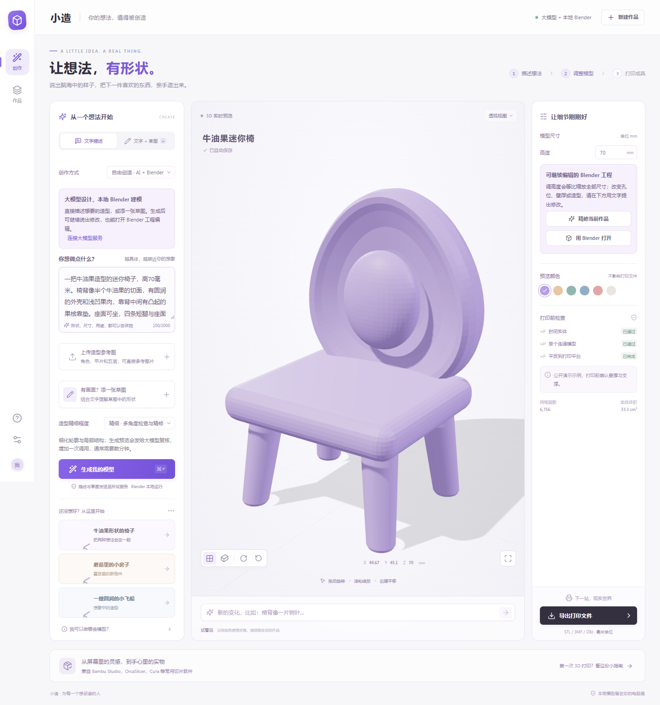

# Xiaozao · 小造

A local 3D creation workbench for text, sketches and reference images, with a Chinese interface, local Blender execution and printable mesh checks.

[中文](README.md) · [Contributing](CONTRIBUTING.md) · [Security](SECURITY.md) · [License](LICENSE)



**Early alpha.** Free-form generation can misunderstand a request or fail. This project does not promise arbitrary production-ready models, professional character sculpting or mechanically certified parts. The Meshy adapter has mocked contract coverage, but its real output quality has not been validated.

## Features

- A configured language model writes a new Blender program from text and optional images; Blender runs locally.
- Local checks cover watertightness, winding, positive volume, connected material and explicit outer dimensions. Errors can be sent back for repair.
- Fine mode reviews multiple views of the actual geometry. A failed refinement preserves the valid baseline.
- Continue editing, change height locally, save projects and export STL / 3MF / OBJ. Blender projects also provide `.blend` and Python source.
- Optional Meshy text / image generation with a separate API key; preserve the original GLB, including materials, even when printing checks fail.
- Offline basic mode offers supported shapes and sketch extrusion. It is explicitly a parametric library, separate from free creation.

## Windows quick start

Recommended: Python 3.13, Node.js 24 LTS and a WebGL-capable browser. Dependency minimums are Python 3.11 and Node.js 22.12. Windows x64 is the primary validation platform.

1. Download and extract the source.
2. Run `启动小造.cmd` or `powershell -NoProfile -ExecutionPolicy Bypass -File .\start.ps1`. First launch installs dependencies and builds the frontend.
3. Open `http://127.0.0.1:8765`. Select the basic mode for a first trial without credentials.
4. For AI + Blender, run `安装Blender建模.cmd`, then configure your own compatible language-model service in Settings. Image input and fine mode require vision support.
5. Export 3MF and inspect the result in a slicer. Stop with `停止小造.cmd`.

No API keys, model weights or Blender binaries are included. Settings are stored locally in plaintext in `data/settings.json`; models live in `data/models/`. Cloud requests may incur charges. Meshy requires its own key and account. See [configuration](docs/configuration.md).

Linux and macOS users can follow the manual commands in [development](docs/development.md), with their own Blender installation. Full desktop behavior on those platforms is not yet verified. A static GitHub Pages site cannot execute the backend.

## Development

```powershell
python -m venv .venv
.\.venv\Scripts\python.exe -m pip install -r requirements.txt
npm ci
npm run build
.\.venv\Scripts\python.exe -m pytest -q
npx playwright install chromium
npm run test:e2e
```

Browser tests start a disposable server on port8766 and do not read personal credentials or call paid generation services. Blender-dependent tests explicitly skip when Blender is missing; the Windows CI workflow installs Blender for integration coverage. GitHub CI is supplied as configuration, not a claim of an already successful hosted run.

## Limits and licensing

Passing mesh checks is not physical print, wall thickness, load, clearance or support validation. Texture and lighting detail is not printable geometry. A single reference image cannot specify unseen surfaces exactly. AI programs and imported projects are subject to API restrictions, but these are not OS-level isolation; only import trusted projects and keep the service on localhost.

Original project code is released under [MIT](LICENSE). Dependencies, external model code / weights, Blender and cloud services retain their own terms; see [third-party notices](THIRD_PARTY_NOTICES.md). No endorsement or affiliation with those projects or providers is implied.
