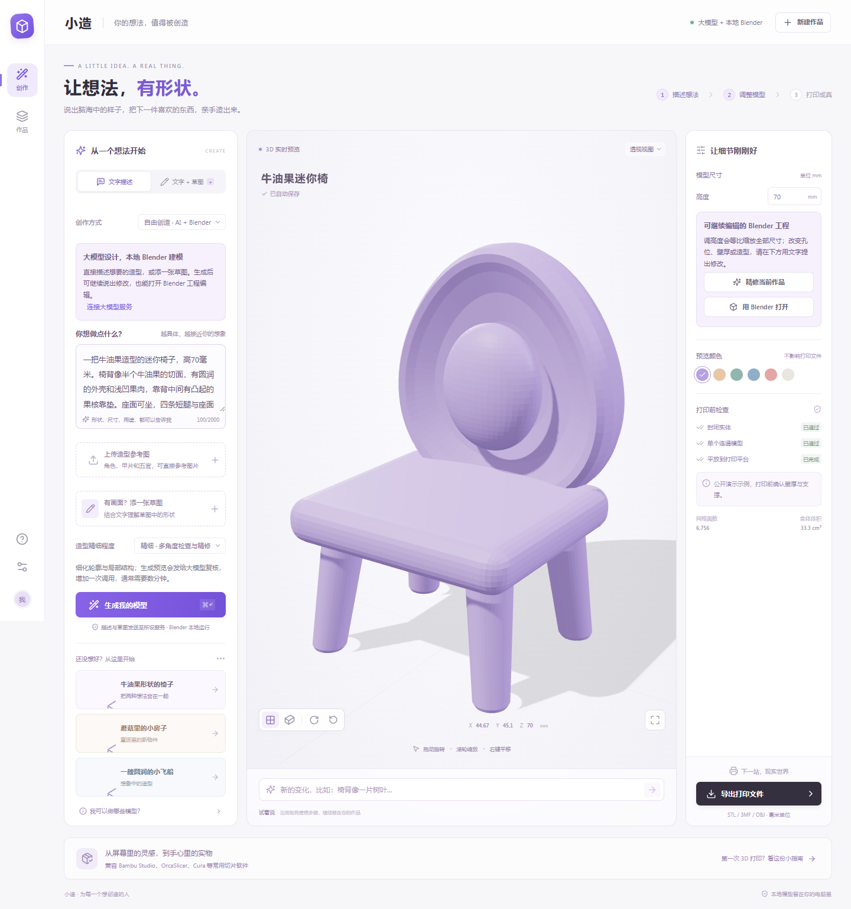
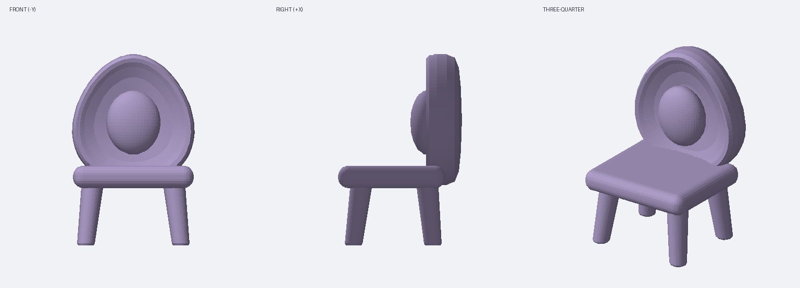

<div align="center">

# 小造 · Xiaozao

**用文字、草图和参考图，把想法变成三维模型。**

本地运行的中文 3D 创作工作台 · AI + Blender · 打印网格检查

[English](README.en.md) · [快速开始](#快速开始windows) · [配置服务](docs/configuration.md) · [参与贡献](CONTRIBUTING.md)


</div>



> **早期版本。** 自由建模不依赖固定造型类别匹配，但可能误解要求或生成失败。专业角色雕刻、任意照片还原、精密装配与“一句话生成任何东西”均不作保证。Meshy 通道已做模拟接口测试，尚未验证真实服务生成质量。

## 可以做什么

- **自由创造**：大模型理解描述 / 草图 / 参考图，编写新的 Blender 程序，本机 Blender 完成建模。
- **检查与精修**：检查封闭性、法线、正体积、连通性和明确的外廓尺寸；错误自动修正。精细模式用实际网格的多个角度进行外观复核，失败时保留合法版本。
- **继续修改**：对已有作品描述修改，调整高度或打开 Blender 工程。已有项目导入与等比缩放可本地完成。
- **打印导出**：STL、毫米单位3MF、OBJ；Blender 路线另有 `.blend` 和 Python，JSON 保存可恢复项目信息。
- **专业形象入口**：对接 Meshy 文字 / 单图生成，保留原始带材质GLB。不满足打印要求的形象仍可保存，标记待修复。
- **本地基础模式**：20种已支持动物 / 部件及草图轮廓拉伸，无需云服务，适合快速试用。
- **工作台体验**：旋转 / 缩放 / 多视图、线框、草图、作品库、进度、取消和失败恢复，支持手机浏览。

## 快速开始（Windows）

准备 **Python 3.13（推荐）**、**Node.js 24 LTS（推荐）** 和支持 WebGL 的浏览器。代码依赖要求 Python 3.11+、Node.js 22.12+。当前主要验证 Windows x64；本机日常启动需要 Python，源码首次构建还需要 Node.js 和网络。

1. 下载仓库源码并解压到自己的文件夹。
2. 双击 **`启动小造.cmd`**。首次启动会创建虚拟环境、安装依赖并构建网页，随后打开 `http://127.0.0.1:8765`。
3. 先选 **“精确尺寸 · 基础部件”**，输入 `安装板，长80宽40厚5，4个孔，孔径5毫米`，无需密钥即可生成。
4. 使用自由创造时，先双击 **`安装Blender建模.cmd`**，再到设置填写自己的大模型服务，开启 AI 建模。
5. 检查外观、调整尺寸，然后下载3MF，在切片软件中检查支撑和壁厚。

关闭网页不等于关闭服务；双击 **`停止小造.cmd`** 停止。作品保存在 `data/models/`，服务密钥保存在本机 `data/settings.json`。源码不包含任何可用密钥。

终端启动：

```powershell
powershell -NoProfile -ExecutionPolicy Bypass -File .\start.ps1 -NoBrowser
```

其他系统可按 [开发指南](docs/development.md) 手动运行，须自行安装 Blender；未做完整跨平台桌面验收。GitHub Pages 不能运行 Python / Blender 后端。

## 选择创作方式

| 方式 | 在哪里计算 | 需要什么 | 当前适合 |
| --- | --- | --- | --- |
| AI + Blender | 大模型在所配服务，Blender在本机 | 兼容 Chat Completions 的模型服务；参考图 / 精细模式需视觉能力 | 新造型、摆件、结构方案和程序化建模 |
| 专业形象 · Meshy | 云端生成，本机检查 | 独立 Meshy API 密钥，独立计费 | 角色与复杂形象探索；质量尚待真实服务验证 |
| 基础部件 | 全部本机 | 无密钥 | 已支持的简单造型与轮廓拉伸 |

详细设置、费用与发送数据见 [配置说明](docs/configuration.md)。文字大模型的密钥不能替代 Meshy 密钥。实验性本地 Shap-E 不是默认路线，也未在公开源码包中附带权重与第三方源码，见 [可选本地实验](docs/local-experiment.md)。

## 公开示例



`examples/` 提供基础模型，以及可本地重建的牛油果椅子与6毫米双孔理线夹。JSON 可从工作台“导入项目”恢复；Blender 示例需安装 Blender，但导入和等比改尺寸不需要服务密钥。它们是示例，未经过实物打印与承载验证。见 [示例说明](examples/README.md)。

## 打印与隐私边界

通过网格检查表示可以作为切片输入，不代表全部壁厚、悬垂支撑、承载或装配间隙正确。颜色、法线贴图和光照不是可打印几何。单张图看不到的背面由生成服务推测。

AI + Blender 会发送文字、参考图、程序、必要错误和精修预览到所配服务。Meshy 会收到文字或图片，可能收费。基础部件模式不需要这些云端调用。详情见 [打印说明](docs/printing.md) 和 [安全与隐私](SECURITY.md)。

本项目仅面向单人本机使用，没有账号隔离；AI 程序执行限制不是操作系统安全隔离，不应直接开放公网，也不要导入不可信项目。

## 开发、测试与开源

```powershell
python -m venv .venv
.\.venv\Scripts\python.exe -m pip install -r requirements.txt
npm ci
npm run build
.\.venv\Scripts\python.exe -m pytest -q
npx playwright install chromium
npm run test:e2e
```

浏览器测试自动启动8766端口的临时环境，不读取个人服务配置，不调用真实付费模型；未安装 Blender 时相应集成项明确跳过。GitHub CI 配置包含后端检查和 Windows Blender 集成流程，只有上传到仓库后才会在 GitHub 执行。

- [架构与数据流](docs/architecture.md)
- [开发指南](docs/development.md) · [故障排查](docs/troubleshooting.md)
- [验证与依赖审计记录](docs/validation.md)
- [GitHub 发布步骤](docs/publishing.md) · [路线图](docs/roadmap.md)
- [贡献指南](CONTRIBUTING.md) · [更新记录](CHANGELOG.md)

项目原创源码使用 [MIT License](LICENSE)。依赖、Blender、模型权重和外部服务采用各自许可 / 条款，见 [第三方说明](THIRD_PARTY_NOTICES.md)。本仓库不附带 Blender、模型权重、个人作品或预配置服务账户。
