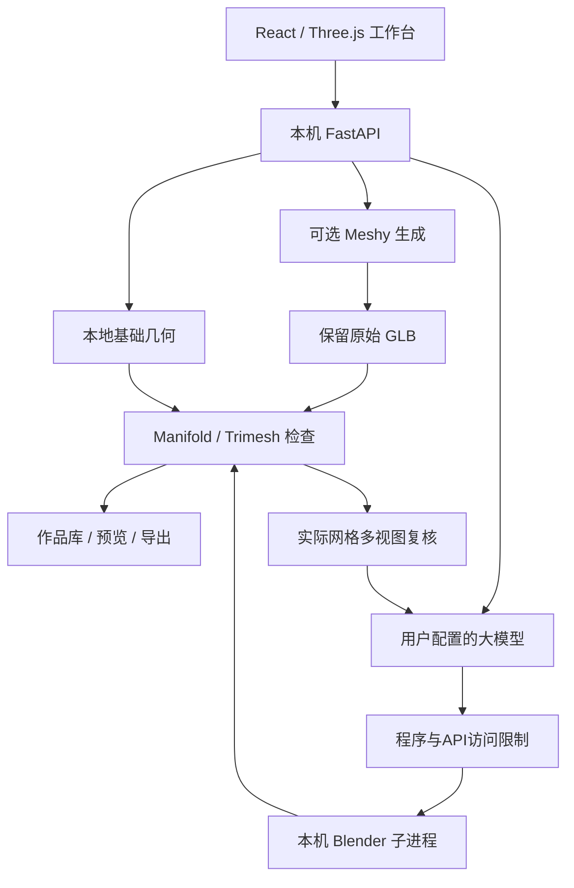

# 架构与数据流

`src/App.tsx` 管理输入、任务状态、编辑和设置；`Viewer.tsx` 展示实际几何，`Sketch.tsx` 提供轮廓输入。前后端同源部署，开发时由 Vite 代理 `/api`。

`server/app.py` 管理任务、数据保存和接口；`blender_bridge.py` 调用模型、执行程序、恢复失败与精修。`blender_policy.py` 限制生成程序，`blender_worker.py` 在子进程执行；限制不是OS隔离。`model_views.py` 从实际网格生成CPU预览。

`cloud3d.py` 创建和查询独立3D服务任务，保存原始GLB，再检查本地打印几何。创建请求不会自动重发，避免在结果不确定时重复付费。打印失败不通过删除配件伪造成功。

`modeling.py` 与 `organic.py` 实现本地基础造型；可选的 `neural.py` / `neural_worker.py` 是非默认实验路线，不附带权重。

任务在后台线程执行，自由建模每次一个。刷新网页可继续查询当前任务；服务停止后，Blender路线的保存尝试可以用于修复恢复。个人状态放在忽略目录，公开示例与源码分开。

后端主要接口：`/api/health`、`/api/settings`、`/api/generate`、`/api/jobs/{id}`、`/api/models` 和作品下载；运行后可在 `/api/docs` 查看具体结构。没有登录、远程账户、多租户或公开网络部署能力。
